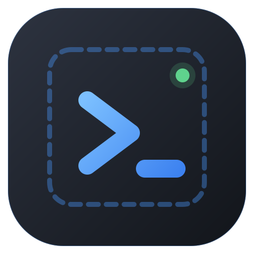
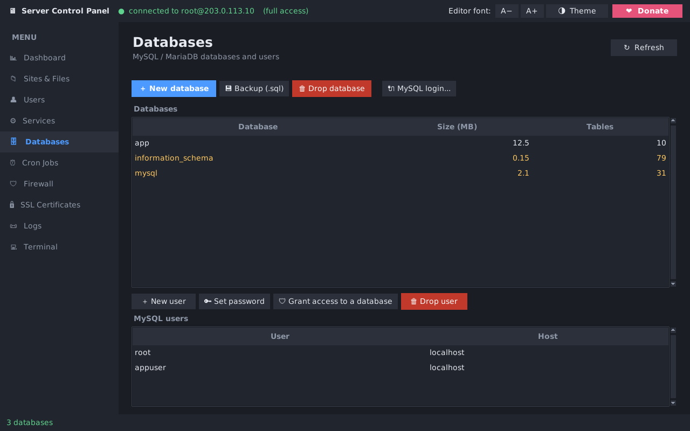
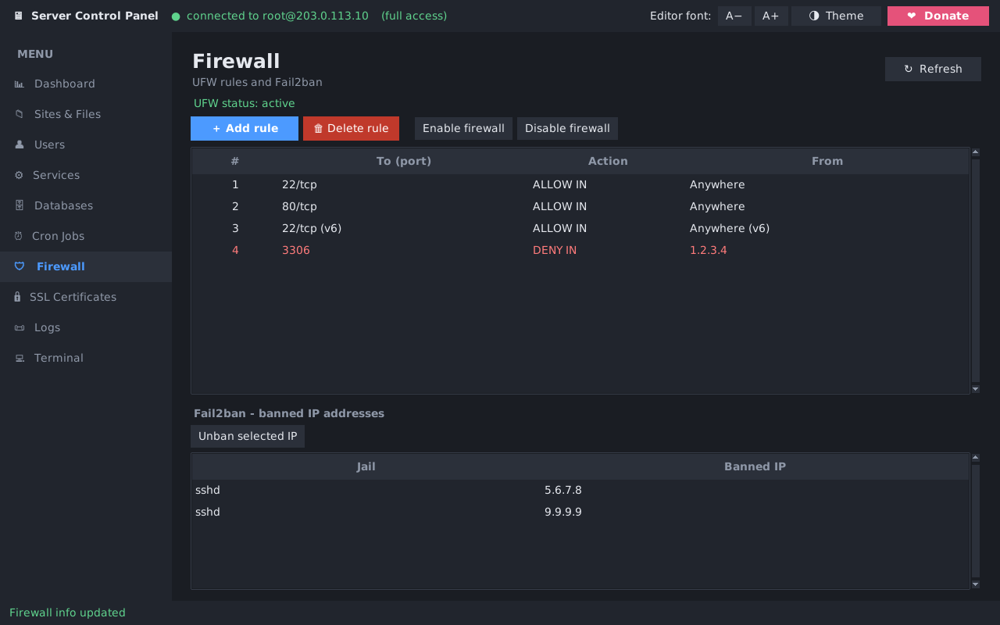

<div align="center">

# <br>Panelless

### Remote Linux Server Management Client

**Manage your Linux servers remotely from your desktop.**

Panelless is a professional desktop application that lets you connect to, monitor, configure, and manage Linux servers remotely through SSH and SFTP — all from one unified graphical interface.

No server-side installation. No additional agents. No dependency on your hosting control panel.

[](../../releases)
[](https://www.python.org/)
[](#installation)
[](#how-it-works)
[](https://www.reddit.com/r/Panelless/)
[](https://t.me/Panelless1)

[**Download**](../../releases) · [**Features**](#features) · [**How It Works**](#how-it-works) · [**Installation**](#installation) · [**Pricing**](#pricing) · [**Community**](#community) · [**Security**](#security-and-permissions)


</div>

---

## What is Panelless?

**Panelless is a remote Linux server management client for desktop computers.**

It gives you a graphical interface to manage your Linux servers directly from your computer without installing any additional software or control panel on the remote server.

Instead of connecting through SSH and manually executing Linux commands for every operation, Panelless provides dedicated management tools in one application.

You can manage files, websites, Linux users, system services, databases, scheduled tasks, firewall rules, SSL certificates, server logs, and more.

### What makes Panelless different?

- **Remote Management:** Connect to your Linux server directly from your desktop.
- **Agentless Architecture:** Uses standard SSH/SFTP. Nothing needs to be installed or running in the background on the server.
- **Independent Operation:** Works even if FASTPANEL, cPanel, or another hosting control panel is unavailable.
- **Unified Interface:** Manage essential server operations without switching between multiple tools.
- **Secure Credentials:** Your login password stays in memory during the current session and is never saved to disk.

---

## How It Works

Panelless runs on your local computer and communicates directly with your remote Linux server.

<pre>
┌──────────────────────────────┐
│       Your Computer          │
│                              │
│          Panelless           │
│      Desktop Application     │
│                              │
└──────────────┬───────────────┘
               │
               │  SSH / SFTP
               │  Encrypted Connection
               ▼
┌──────────────────────────────┐
│       Remote Linux Server    │
│                              │
│  • Files & Websites          │
│  • Linux Users               │
│  • System Services           │
│  • MySQL / MariaDB           │
│  • Firewall & Security       │
│  • SSL Certificates          │
│  • Logs & Terminal           │
│                              │
└──────────────────────────────┘
</pre>

### Getting Started

1. Install or run Panelless on your desktop computer.
2. Enter your server IP address and SSH port.
3. Authenticate using your Linux username and password or SSH private key.
4. Connect to your server.
5. Manage your server through the graphical interface.

> **Important:** Panelless is installed on your local computer, not on your Linux server. It communicates remotely using SSH and SFTP.

---

## Who Is Panelless For?

| Role | How Panelless Helps |
|---|---|
| **Server Administrators** | Manage multiple Linux servers from one desktop application |
| **Web Developers** | Access website files, databases, services, and server logs instantly |
| **Hosting Providers** | Administer servers without relying entirely on a web control panel |
| **VPS Owners** | Manage your VPS without installing another server-side control panel |
| **System Administrators** | Perform common Linux tasks through a clean graphical interface |

---

## Features

Panelless brings essential Linux server administration tools into one desktop application.

| Module | Capabilities |
|---|---|
| **📊 Dashboard** | Live CPU, memory, disk, load average, and service status |
| **📁 Sites & Files** | Browse directories, edit code with syntax highlighting, line numbers and search; upload, download, rename, delete, zip and unzip |
| **👤 Users** | List, create and delete users; change passwords; lock/unlock accounts; manage shell and sudo rights |
| **⚙️ Services** | Start, stop, restart, reload, enable/disable at boot, and read service logs |
| **🗄️ Databases** | MySQL / MariaDB database and user management, permissions, SQL backups, built-in SQL console, phpMyAdmin shortcut and password management |
| **⏰ Cron Jobs** | View and edit scheduled tasks for any user |
| **🛡️ Firewall** | Manage UFW rules and Fail2ban banned IPs, including unban operations |
| **🔒 SSL** | Check actual SSL certificate expiration dates for websites |
| **📜 Logs** | View, tail and filter server log files with live updates |
| **💻 Terminal** | Execute Linux commands directly on the remote server |

**Interface extras:** dark and light themes · adjustable editor font size · integrated file editor · interactive terminal.

---

## Screenshots

### Dashboard & File Management

<p>


</p>

### Users & Database Management

<p>


</p>

### Firewall Management

<p>

</p>

---

## Database Management Tools

### Built-in SQL Console

- Select a database and execute SQL statements.
- Execute multiple statements at once.
- Run only the selected SQL text using `Ctrl+Enter`.
- Display query results in formatted tables.
- Highlight SQL execution errors.

### Smart Root Authentication

Automatically tries several available authentication methods:

- `/root/.my.cnf`
- MySQL socket authentication
- Debian maintenance account

The application remembers the method that works.

### phpMyAdmin Shortcut

Open phpMyAdmin directly in your browser:

```
https://SERVER-IP:8888/phpmyadmin/
```

The address is editable and remembered between sessions.

---

## Installation

Panelless is a desktop application. Install or run it on your own computer, then connect to your Linux server remotely.

### Windows Executable *(Recommended)*

1. Go to the [**Releases**](../../releases) page.
2. Download `Panelless.exe`.
3. Run the application — no installation required.
4. Enter your server credentials and connect.

### Run From Source *(Windows / macOS / Linux)*

**Requirements:** Python 3.9+, Tkinter (included in official Python installers), Paramiko

```bash
pip install paramiko
python panelless.py
```

### Build the Executable Yourself

```bash
# Place build_exe.bat next to panelless.py, then run:
build_exe.bat
# Output appears in dist/
```

GitHub Actions can automatically build and attach the executable to a release when you push a version tag (e.g. `v1.0.2`).

---

## Security and Permissions

Panelless connects using your existing Linux authentication credentials.

| Authentication | Access Level |
|---|---|
| **`root`** (password or SSH key) | Full administrative access |
| **Normal user with sudo** | Administrative commands run via `sudo` using the login password |
| **Normal user without sudo** | Limited to that user's own permissions |

### Credential Storage

- Login password is kept **in memory only** and cleared when the application closes.
- Passwords are **never saved to disk**.
- Only host, port, username, SSH key path, theme, and editor font size are stored in `~/.panelless.json`.
- Edited file backups are stored in `~/panelless_backups` on the remote server, outside the website root.
- Destructive operations (deleting users or databases) require typing the target name to confirm.

> **Sudo note:** If `Defaults requiretty` is set in the server's sudoers configuration, `sudo -S` will not work without a terminal session.

---

## Important Notes

- Panelless modifies the Linux operating system directly through SSH.
- Changes made through Panelless may not automatically appear in your hosting control panel.
- Hosting panels such as FASTPANEL and cPanel maintain their own databases. They may not recognize users or databases created or deleted directly through Panelless.
- Panelless does not replace a hosting panel's website management interface — it provides direct access to the underlying Linux server.
- Use Panelless only on servers you own or are authorized to administer.

---

## Pricing

Panelless is independently developed and offered under a proprietary license.

| Plan | Price | Devices | Support |
|---|---|---|---|
| **Solo** | $7 / month | 1 device | Community |
| **Pro** | $15 / month | 3 devices | Email |
| **Team** | $29 / month | 10 devices | Priority |
| **Lifetime** | $39 one-time | 1 device | Community |

> Lifetime license is the best way to get started and support ongoing development.

---

## Community

Join the Panelless community to get help, share feedback, and follow updates.

- 💬 **Reddit:** [r/Panelless](https://www.reddit.com/r/Panelless/) — discussions, questions, and announcements
- 📣 **Telegram:** [t.me/Panelless1](https://t.me/Panelless1) — release updates and news
- 🐛 **GitHub Issues:** [Report a bug or request a feature](../../issues)

---

## Support the Project

Panelless is built and maintained by one developer. Your support funds ongoing development, bug fixes, and new features.

<div align="center">

### ❤️ Support Panelless

[](https://paypal.me/MahmoudOsama657)

[**Donate via PayPal →**](https://paypal.me/MahmoudOsama657)

</div>

You can also support the project by:

- ⭐ Starring this repository
- Reporting bugs and suggesting improvements
- Sharing Panelless with other Linux server administrators

---

## License

Panelless is distributed under a **Proprietary License**.

See [LICENSE](LICENSE) for the full terms.

---

<div align="center">

**Panelless** · *Your Linux Server. Your Desktop. Full Control.*

[Download](../../releases) · [r/Panelless](https://www.reddit.com/r/Panelless/) · [Telegram](https://t.me/Panelless1)

</div>
