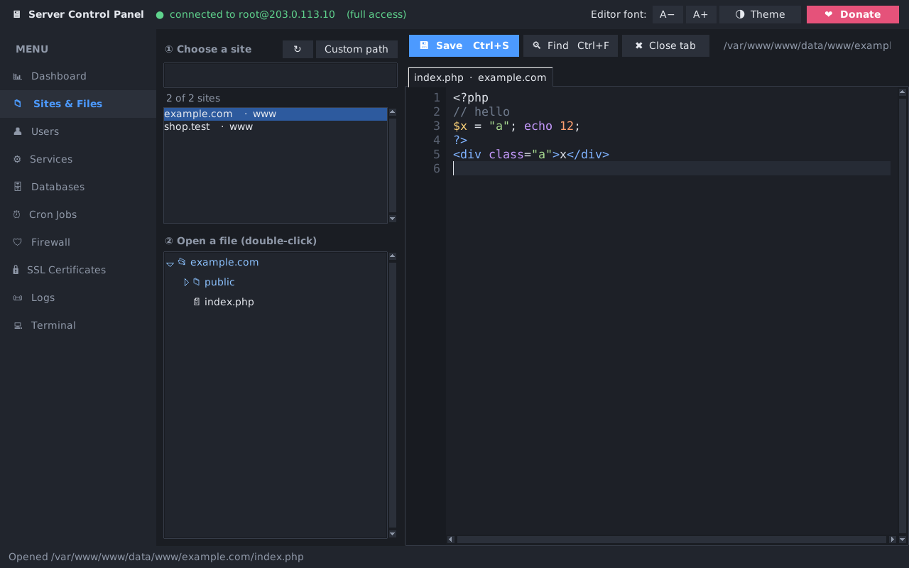

<div align="center">

#  Panelless

### A server control panel, without a panel.

Manage your Linux server over **SSH/SFTP only**. Nothing to install on the server,
and it keeps working even when your hosting panel is down.

[](../../releases)
[](https://www.python.org/)
[](#installation)
[](https://paypal.me/MahmoudOsama657)

[**Download**](../../releases) · [**Features**](#features) · [**Installation**](#installation) · [**Security**](#security-and-permissions) · [**Support**](#support-the-project)


</div>

---

## Why Panelless?

Hosting panels such as FASTPANEL or cPanel are convenient until they go down, or until you need to fix something
they cannot. Panelless gives you a fast, native desktop interface to the server itself:

- **Agentless.** Everything runs over a standard SSH connection. No daemon, no open ports, no installation.
- **Independent.** Works when your hosting panel is stopped, broken or unreachable.
- **Complete.** Files, users, services, databases, cron, firewall, SSL, logs and a terminal in one window.
- **Private.** Your passwords are never written to disk.

## Features

| Page | What you can do |
|------|-----------------|
| **📊 Dashboard** | Live CPU, memory, disk, load average and service status |
| **📁 Sites & Files** | Browse any site, edit code with syntax colors, line numbers and search; upload, download, rename, delete, zip and unzip |
| **👤 Users** | List, create and delete users; change password; lock / unlock; shell; sudo rights |
| **⚙ Services** | Start, stop, restart, reload, enable / disable at boot, and read service logs |
| **🗄 Databases** | MySQL / MariaDB: create and drop databases, users and grants, `.sql` backups, **built-in SQL console**, **one-click phpMyAdmin**, password change with generator |
| **⏰ Cron Jobs** | View and edit the crontab of any user |
| **🛡 Firewall** | UFW rules and Fail2ban banned IPs, with unban |
| **🔒 SSL** | Check the real certificate expiry of every site |
| **📜 Logs** | Tail and filter log files, with live follow |
| **💻 Terminal** | Run commands directly on the server |

Dark and light themes, adjustable editor font.

<p>
  
  
</p>
<p>
  
  
</p>

### Database tools

- **SQL console.** Pick a database, run one or several statements, or just the selected text with `Ctrl+Enter`. Results are shown as formatted tables with errors highlighted.
- **phpMyAdmin shortcut.** Opens `https://SERVER-IP:8888/phpmyadmin/` in your browser. The address is editable and remembered.
- **Smart root login.** Tries `/root/.my.cnf`, socket authentication and the Debian maintenance account automatically, and remembers the one that works.
- **Password management.** Change any MySQL user's password, with an optional strong random password generator.

## Installation

### Windows executable

1. Download `Panelless.exe` from the [**Releases**](../../releases) page.
2. Run it. No installation required.

### From source

```bash
pip install paramiko
python panelless.py
```

Requires **Python 3.9+** with Tk (included in the official Windows and macOS installers).

### Build the executable yourself

Put `build_exe.bat` next to `panelless.py` and run it. The executable appears in `dist/`.
Pushing a tag such as `v1.0.2` makes GitHub Actions build it and attach it to a release automatically.

## Security and permissions

| Login | Behaviour |
|-------|-----------|
| **`root`** (password or SSH key) | Full access. Recommended. |
| **Normal user with sudo** | Every administrative command runs through `sudo` using the password you entered at login. |
| **Normal user without sudo** | Commands run as that user, so only what that user may do will work. |

- Your password is **kept in memory for the current session only** and cleared when you close the app. It is never saved to disk.
- Only host, port, user, key path, theme and font size are stored, in `~/.panelless.json`.
- Backups of edited files are kept on the server in `~/panelless_backups`, outside the web root.
- Destructive actions (deleting a user or a database) require you to type the name to confirm.

> **Note:** if `Defaults requiretty` is enabled in the server's sudoers, `sudo -S` cannot work without a terminal.

## Important notes

- Changes are applied **directly to the operating system**. A hosting panel such as FASTPANEL keeps its own database and will not know about users or databases created or removed here.
- Use Panelless only on servers you own or are authorized to administer.

## Support the project

Panelless is built and maintained by one developer, and it is free to use.
If it saved you time, please consider supporting its development. Every contribution helps keep it updated.

<div align="center">

### ❤️ [**Donate via PayPal →**](https://paypal.me/MahmoudOsama657)

[](https://paypal.me/MahmoudOsama657)

`https://paypal.me/MahmoudOsama657`

</div>

You can also help by starring the repository ⭐, reporting bugs, and sharing the tool with others.

## License

Proprietary License. See [LICENSE](LICENSE).

---

<div align="center">

**Panelless**, a control panel without a panel.

</div>
