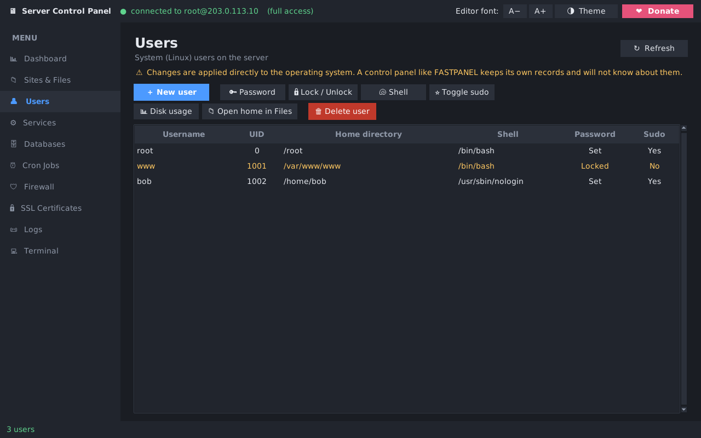

 <div align="center">

# <br>Panelless

### Remote Linux Server Management Client

**Manage your Linux servers remotely from your desktop.**

Panelless is a professional desktop application that lets you connect to, monitor, configure, and manage Linux servers remotely through SSH and SFTP — all from one unified graphical interface.

No server-side installation. No additional agents. No dependency on your hosting control panel.

[](../../releases)
[](https://www.python.org/)
[](#installation)
[](#how-it-works)

[**Download**](../../releases) · [**Features**](#features) · [**How It Works**](#how-it-works) · [**Installation**](#installation) · [**Security**](#security-and-permissions) · [**Support**](#support-the-project)


</div>

---

## What is Panelless?

**Panelless is a remote Linux server management client for desktop computers.**

It gives you a graphical interface to manage your Linux servers directly from your computer without installing any additional software or control panel on the remote server.

Instead of connecting through SSH and manually executing Linux commands for every operation, Panelless provides dedicated management tools in one application.

You can manage files, websites, Linux users, system services, databases, scheduled tasks, firewall rules, SSL certificates, server logs, and more.

### What makes Panelless different?

- **Remote Management:** Connect to your Linux server directly from your desktop.
- **Agentless Architecture:** Uses standard SSH/SFTP. Nothing needs to be installed or running in the background on the server.
- **Independent Operation:** Works even if FASTPANEL, cPanel, or another hosting control panel is unavailable.
- **Unified Interface:** Manage essential server operations without switching between multiple tools.
- **Secure Credentials:** Your login password stays in memory during the current session and is never saved to disk.

## How It Works

Panelless runs on your local computer and communicates directly with your remote Linux server.

<pre>
┌──────────────────────────────┐
│       Your Computer          │
│                              │
│          Panelless            │
│      Desktop Application     │
│                              │
└──────────────┬───────────────┘
               │
               │  SSH / SFTP
               │  Encrypted Connection
               ▼
┌──────────────────────────────┐
│       Remote Linux Server    │
│                              │
│  • Files & Websites          │
│  • Linux Users               │
│  • System Services           │
│  • MySQL / MariaDB           │
│  • Firewall & Security       │
│  • SSL Certificates          │
│  • Logs & Terminal           │
│                              │
└──────────────────────────────┘
</pre>

### Getting started

1. Install or run Panelless on your desktop computer.
2. Enter your server IP address and SSH port.
3. Authenticate using your Linux username and password or SSH private key.
4. Connect to your server.
5. Manage your server through the graphical interface.

**Important:** Panelless is installed on your local computer, not on your Linux server. It communicates remotely using SSH and SFTP.

## Who Is Panelless For?

Panelless is designed for:

- **Server Administrators:** Manage multiple Linux servers from a desktop application.
- **Web Developers:** Access website files, databases, services, and server logs.
- **Hosting Providers:** Perform server administration without relying entirely on a web hosting panel.
- **VPS Owners:** Manage your VPS without installing another server-side control panel.
- **System Administrators:** Perform common Linux administration tasks through a graphical interface.

## Features

Panelless brings essential Linux server administration tools into one desktop application.

| Module | Capabilities |
|---|---|
| **📊 Dashboard** | Live CPU, memory, disk, load average, and service status |
| **📁 Sites & Files** | Browse directories, edit code with syntax highlighting, line numbers and search; upload, download, rename, delete, zip and unzip |
| **👤 Users** | List, create and delete users; change passwords; lock/unlock accounts; manage shell and sudo rights |
| **⚙ Services** | Start, stop, restart, reload, enable/disable at boot, and read service logs |
| **🗄 Databases** | MySQL / MariaDB database and user management, permissions, SQL backups, built-in SQL console, phpMyAdmin shortcut and password management |
| **⏰ Cron Jobs** | View and edit scheduled tasks for any user |
| **🛡 Firewall** | Manage UFW rules and Fail2ban banned IPs, including unban operations |
| **🔒 SSL** | Check actual SSL certificate expiration dates for websites |
| **📜 Logs** | View, tail and filter server log files with live updates |
| **💻 Terminal** | Execute Linux commands directly on the remote server |

Additional interface features:

- Dark and light themes.
- Adjustable editor font size.
- Integrated file editor.
- Remote file management.
- Interactive terminal.

## Screenshots

### Server File Management

<p>


</p>

### Database & Firewall Management

<p>


</p>

## Database Management Tools

Panelless includes additional tools for MySQL and MariaDB administration.

### Built-in SQL Console

- Select a database and execute SQL statements.
- Execute multiple statements.
- Execute only the selected SQL text using `Ctrl+Enter`.
- Display query results in formatted tables.
- Highlight SQL execution errors.

### phpMyAdmin Shortcut

Open phpMyAdmin directly in your browser through:

`https://SERVER-IP:8888/phpmyadmin/`

The address is editable and remembered.

### Smart Root Authentication

Automatically tries several available authentication methods:

- `/root/.my.cnf`
- MySQL socket authentication.
- Debian maintenance account.

The application remembers the authentication method that works.

### Database Password Management

- Change MySQL user passwords.
- Generate strong random passwords.
- Manage database users and permissions.

## Installation

Panelless is a desktop application. Install or run it on your own computer, then connect to your Linux server remotely.

### Windows Executable

1. Visit the [**GitHub Releases**](../../releases) page.
2. Download `Panelless.exe`.
3. Run the application.
4. Connect to your Linux server using SSH credentials.

No additional installation is required.

### Run From Source

Requirements:

- Python 3.9+
- Tkinter
- Paramiko

Install the dependency:

```bash
pip install paramiko
```

Run the application:

```bash
python panelless.py
```

Tkinter is included in the official Windows and macOS Python installers.

### Build the Executable Yourself

1. Place `build_exe.bat` next to `panelless.py`.
2. Run `build_exe.bat`.
3. The generated executable will appear in the `dist/` directory.

GitHub Actions can automatically build the executable and attach it to a release when a version tag such as `v1.0.2` is pushed.

## Security and Permissions

Panelless connects using your existing Linux authentication credentials.

| Authentication | Access |
|---|---|
| **`root`** (password or SSH key) | Full administrative access |
| **Normal user with sudo** | Administrative commands are executed through sudo using the password provided at login |
| **Normal user without sudo** | Operations are limited to the permissions of that user |

### Credential Storage

- Your login password is kept **in memory for the current session only**.
- The password is cleared when you close the application.
- Passwords are never saved to disk.
- Only the host, port, username, SSH key path, theme, and editor font size are stored in `~/.panelless.json`.
- Backups of edited files are stored remotely in `~/panelless_backups`, outside the website root.
- Destructive operations, such as deleting users or databases, require typing the target name to confirm.

**Sudo compatibility note:** If `Defaults requiretty` is enabled in the server's sudoers configuration, `sudo -S` cannot work without a terminal.

## Important Notes

- Panelless modifies the Linux operating system directly.
- Changes made through Panelless may not automatically appear in your hosting control panel.
- Hosting panels such as FASTPANEL and cPanel maintain their own databases and management systems. They may not recognize users or databases created or deleted directly through Panelless.
- Panelless does not replace a hosting panel's website management interface. It provides direct access to underlying Linux server administration.
- Use Panelless only on servers you own or are authorized to administer.

## Support the Project

Panelless is independently developed and maintained.

Your support helps fund ongoing development, maintenance, new features, bug fixes, and future updates.

If Panelless saves you time or makes server administration easier, consider supporting its development.

<div align="center">

### ❤️ Support Panelless Development

[](https://paypal.me/MahmoudOsama657)

[**Donate via PayPal →**](https://paypal.me/MahmoudOsama657)

`https://paypal.me/MahmoudOsama657`

</div>

You can also support the project by:

- ⭐ Starring the GitHub repository.
- Reporting bugs and suggesting improvements.
- Sharing Panelless with other Linux server administrators.

## License

Panelless is distributed under a **Proprietary License**.

See [LICENSE](LICENSE) for the full licensing terms.

---

<div align="center">

**Panelless**

*Your Linux Server. Your Desktop. Full Control.*

Remote Linux Server Management Client

</div>
