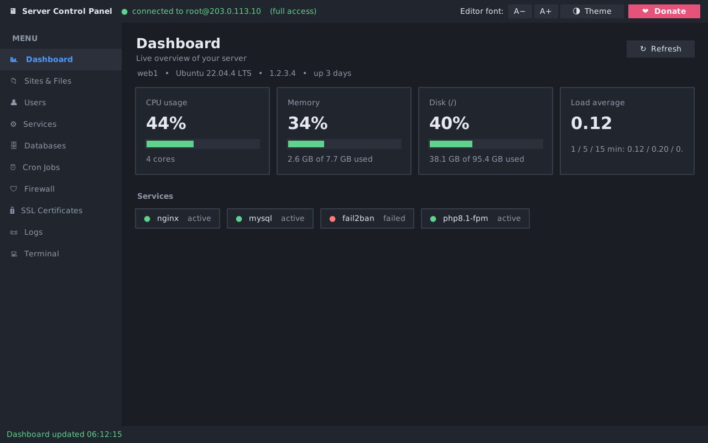

# Panelless
A desktop control panel for Linux servers (built with FASTPANEL-style hosting servers in mind).

# Server Control Panel (over SSH)

A desktop control panel for Linux servers (built with FASTPANEL-style hosting servers in mind).
It talks to the server **only through SSH/SFTP** - nothing is installed on the server, and it keeps
working even when your web hosting panel is down.



## Features

| Page | What you can do |
|------|-----------------|
| **Dashboard** | CPU, memory, disk, load, and service status - live |
| **Sites & Files** | Pick any site, browse files, edit code (syntax colors, line numbers, find), upload / download / rename / delete |
| **Users** | List, create and delete users, change password, lock / unlock, shell, sudo |
| **Services** | Start, stop, restart, reload, enable / disable, view service logs |
| **Databases** | MySQL / MariaDB: create / drop databases, users, grants, `.sql` backup download |
| **Cron Jobs** | View and edit any user's crontab |
| **Firewall** | UFW rules + Fail2ban banned IPs (unban) |
| **SSL** | Check certificate expiry for all sites |
| **Logs** | Tail and filter log files, live follow |
| **Terminal** | Run commands (non-interactive) |

Dark and light themes, adjustable editor font, English UI.

<p>
  
  
</p>
<p>
  
  
</p>

## Run from source

```bash
pip install -r requirements.txt
python server_panel.py
```

Requires Python 3.9+ with Tk (included in the official Windows / macOS installers).

## Windows .exe

* **Download:** grab `ServerPanel.exe` from the [Releases](../../releases) page, or
* **Build it yourself:** put `build_exe.bat` next to `server_panel.py` and run it. The exe appears in `dist/`.

Pushing a tag such as `v1.0.0` makes GitHub Actions build the exe and attach it to a release automatically.

## Login and permissions

* Best: log in as `root` (password or SSH key).
* A normal user works too. If that user has **passwordless sudo**, file access and admin pages use it automatically.
  Without sudo, the panel runs commands as that user, so only what that user may do will work.
* Your password is **never saved** on disk. Only host, port, user, key path, theme and font size are stored in
  `~/.server_panel.json`.

## Important notes

* Changes are applied directly to the operating system. A hosting panel like FASTPANEL keeps its own database and
  will not know about users / databases created or removed here.
* Backups of edited files are kept on the server in `~/panel_backups`, outside the web root.
* Destructive actions (delete user / database) ask you to type the name to confirm.
* Only use this on servers you own or are authorized to administer.

## Support

If this tool saved you time, you can support its development: **https://paypal.me/MahmoudOsama657**

## License

MIT - see [LICENSE](LICENSE).
